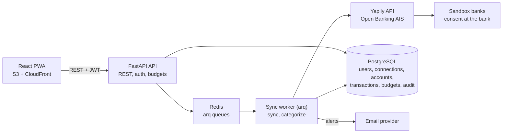
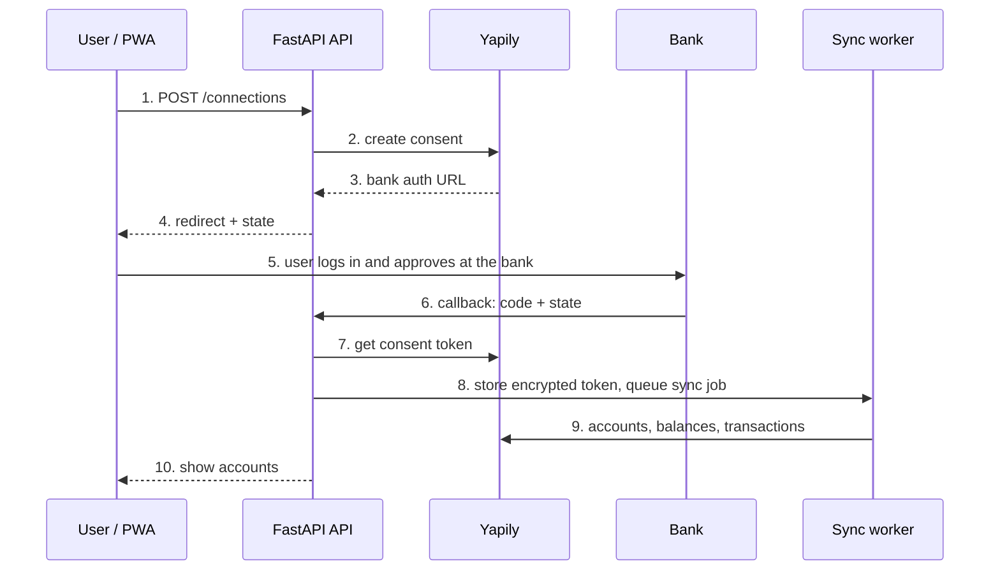

# Finance App — Technical Design

Version 0.2 (Python backend) · Owner: Amr Najip · 2026-11-08

## Overview

The Finance App is a Python 3.12 + FastAPI modular monolith with a React PWA, PostgreSQL, and Redis-backed background jobs, deployed on AWS. It implements the requirements in `BRD.md` (BR-01 to BR-12).

Key design choices:

- **Modular monolith, not microservices.** One deployable keeps a 6-week solo build realistic; module boundaries keep a later split possible.
- **Layered code.** Routes (HTTP only) → services (business logic) → repositories (database access). Routes never touch the database directly.
- **Provider adapter.** All Open Banking calls go through a `BankProvider` protocol; Yapily is the first real implementation, plus a mock provider for tests and offline demos.
- **Async sync.** Bank data is pulled by queued jobs, never inside a user's HTTP request.
- **Idempotent writes.** Every transaction has a natural key, so repeated syncs never duplicate data.
- **Encrypt what matters.** Provider consent tokens are encrypted at the application layer (ADR 0003).

## Architecture



The API answers the PWA and queues work in Redis; the sync worker is the only part that calls Yapily, then writes to PostgreSQL and sends alerts.

## Tech stack

| Layer | Choice | Why |
| --- | --- | --- |
| Language | Python 3.12+ | Widely used at fintechs; strong typing with mypy |
| Web framework | FastAPI + Uvicorn | Async, typed, auto-generated OpenAPI |
| Validation and settings | Pydantic v2, pydantic-settings | Typed request/response models and env config |
| ORM and migrations | SQLAlchemy 2.0 (async) + asyncpg, Alembic | Industry standard; typed `Mapped[]` models |
| Database | PostgreSQL 16 | Reliable, JSONB for raw bank payloads |
| Background jobs | Redis + arq | Async-native queue with cron and retries (Celery noted as alternative in ADR) |
| HTTP client | httpx + tenacity | Async calls to the provider with retry and backoff |
| Auth | PyJWT (access + refresh tokens), argon2-cffi | Standard, auditable |
| Encryption | cryptography (AESGCM) | Vetted AES-256-GCM implementation |
| Logging | structlog (JSON in prod) | Structured, searchable logs; no secrets logged |
| Rate limiting | Fixed-window limiter on async Redis (ADR 0002) | Throttle auth and sync endpoints without blocking the event loop |
| Front end | React + Vite + TypeScript, PWA | Installable on mobile, one codebase |
| UI and charts | Tailwind CSS, Chart.js | Fast to build, clean charts |
| Tests | pytest, pytest-asyncio, httpx AsyncClient, respx, testcontainers; Playwright for E2E | Unit, API, contract and end-to-end |
| Tooling | uv, ruff (lint + format), mypy --strict, pre-commit | Fast, consistent, enforced in CI |
| Containers | Docker, Docker Compose | One-command local run |
| CI/CD | GitHub Actions | Lint, type-check, test, build, deploy |
| Hosting | AWS: ECS Fargate or one EC2, RDS, ElastiCache, S3 + CloudFront | Shows cloud skills; can start on one EC2 to save cost |
| Infra as code | Terraform (week 6, optional) | Reproducible environments |

## Repository structure

One monorepo: the Python backend, the React PWA, infrastructure and docs.

```text
finance-app/
├── backend/
│   ├── pyproject.toml            # deps + ruff, mypy, pytest config (managed by uv)
│   ├── uv.lock
│   ├── alembic.ini
│   ├── alembic/
│   │   ├── env.py
│   │   └── versions/
│   ├── src/finance_app/
│   │   ├── main.py               # app factory: create_app()
│   │   ├── core/                 # config, security (JWT, hashing), crypto, logging, errors
│   │   ├── db/                   # Base, async engine/session, mixins
│   │   ├── api/
│   │   │   ├── deps.py           # get_db, get_current_user, ...
│   │   │   ├── router.py         # mounts /api/v1
│   │   │   └── v1/               # auth, users, institutions, connections, accounts, transactions, categories, budgets, dashboard, health
│   │   ├── modules/              # one package per domain
│   │   │   ├── auth/             # models.py, schemas.py, repository.py, service.py
│   │   │   ├── users/
│   │   │   ├── connections/
│   │   │   ├── accounts/
│   │   │   ├── transactions/
│   │   │   ├── categories/       # rules engine
│   │   │   ├── budgets/
│   │   │   ├── notifications/
│   │   │   └── audit/
│   │   ├── providers/
│   │   │   ├── base.py           # BankProvider Protocol + provider DTOs
│   │   │   ├── yapily.py
│   │   │   ├── mock.py           # for tests and offline demo
│   │   │   └── factory.py
│   │   └── worker/               # arq WorkerSettings, job functions, cron schedules
│   ├── scripts/seed.py           # 12 months of demo data
│   ├── tests/
│   │   ├── unit/
│   │   ├── integration/
│   │   └── api/
│   └── Dockerfile
├── web/                          # React PWA (later)
├── infra/
│   ├── docker/
│   └── terraform/
├── docs/
│   ├── BRD.md
│   ├── technical-design.md
│   └── adr/                      # architecture decision records
├── docker-compose.yml
├── .env.example
├── .pre-commit-config.yaml
├── .github/workflows/ci.yml
├── CLAUDE.md
└── README.md
```

## Backend modules

| Module | Responsibility | BRD |
| --- | --- | --- |
| auth | Register, login, refresh, logout; JWT dependency | BR-01 |
| users | Profile, data export, account deletion | NFR-04 |
| connections | List banks, start consent, handle callback, renew, revoke | BR-02, BR-03, BR-04 |
| accounts | Store and serve accounts and balances; totals per currency | BR-05 |
| transactions | id, account_id, provider_transaction_id, booking_date, amount, currency, description, merchant, status, dedup_key | Unique (account_id, dedup_key); no raw payload stored (NFR-05); category_id added in Week 4 (ADR 0004) |
| categories | id, user_id (null = default), name, icon | 12 defaults seeded by migration; names unique per user (NULLS NOT DISTINCT); no sub-categories yet |
| budgets | id, user_id, category_id, month, limit_amount, currency, alerted_80, alerted_100 | Unique (user_id, category_id, month); spend = net outflow incl. pending; raising a limit re-arms alerts |
| notifications | In-app and email alerts | BR-10 |
| audit | Append-only log of consent, sync, deletion events | NFR-06 |
| providers | `BankProvider` protocol + Yapily and mock adapters | — |
| worker | Sync scheduler, sync job, consent-expiry checker | BR-03, BR-06 |

The `BankProvider` protocol keeps the rest of the code provider-neutral:

```python
from datetime import date
from typing import Protocol


class BankProvider(Protocol):
    """Provider-neutral interface to an Open Banking aggregator (AIS only)."""

    async def list_institutions(self, country: str) -> list[Institution]: ...

    async def create_consent(
        self, user_id: str, institution_id: str, redirect_url: str
    ) -> ConsentStart: ...

    async def complete_consent(self, callback: ConsentCallback) -> ConsentResult: ...

    async def get_accounts(self, consent_token: str) -> list[ProviderAccount]: ...

    async def get_balances(
        self, consent_token: str, account_id: str
    ) -> list[ProviderBalance]: ...

    async def get_transactions(
        self, consent_token: str, account_id: str, date_from: date, date_to: date
    ) -> list[ProviderTransaction]: ...

    async def revoke_consent(self, consent_token: str) -> None: ...
```

Provider DTOs (`Institution`, `ProviderAccount`, ...) are frozen Pydantic models or dataclasses; amounts are `Decimal`, never `float`.

## Data model

Ten core tables; every user-owned row carries `user_id` (directly or through its parent), and deleting a connection cascades to its accounts and transactions. All primary keys are UUIDs; all timestamps are timezone-aware UTC; money is `NUMERIC(18, 2)` with an ISO 4217 currency code.

| Table | Key fields | Notes |
| --- | --- | --- |
| users | id, email, password_hash, created_at | Email unique, stored lower-case |
| refresh_tokens | id, user_id, family_id, token_hash, expires_at, revoked_at | SHA-256 of an opaque token; rotated on each refresh; reuse of a revoked token revokes its family (one family per login) |
| bank_connections | id, user_id, provider, institution_id, institution_name, status, consent_token_enc, provider_consent_id, consent_expires_at, last_synced_at | Status: pending, active, needs_renewal, revoked |
| accounts | id, connection_id, provider_account_id, name, type, currency, account_number_masked | Unique (connection_id, provider_account_id); last 4 characters only |
| balances | id, account_id, type, amount, currency, as_of | Unique (account_id, type), upserted each sync; headline = available, else booked |
| transactions | id, account_id, provider_tx_id, booking_date, amount, currency, description, merchant, status, category_id, dedup_key, raw_json | Unique (account_id, dedup_key) |
| categories | id, user_id (null = default), name, parent_id, icon | 12 defaults seeded |
| category_rules | id, user_id (null = built-in), match_field, operator, value, category_id, priority | User rules first, then priority, then newest; case-insensitive contains/equals/starts_with; 56 built-in rules seeded |
| budgets | id, user_id, category_id, month, limit_amount, currency, alerted_80, alerted_100 | Unique (user_id, category_id, month) |
| audit_log | id, user_id, action, entity, entity_id, metadata, created_at | Append-only |
| notifications | id, user_id, kind, title, body, created_at, read_at | In-app alerts (BR-10); email optional per BRD dependencies |

`dedup_key` = SHA-256 of the provider's transaction ID when present; otherwise of account, booking date, amount and description plus an occurrence number, so identical same-day transactions are both kept. Pending rows the bank stops returning within the sync window are deleted, because a pending transaction often books under a new ID (ADR 0004).

## Bank connection flow



Step 3 uses `oneTimeToken: true`: the callback (step 6) carries a short-lived one-time token that the API exchanges server-side, so the consent token never appears in a URL (ADR 0003). The token is encrypted before it is stored in step 8; the PWA polls `/connections` until the first sync finishes, then shows the accounts. Renewal repeats steps 1–7 for an existing connection.

## API design

REST under `/api/v1`, JSON, JWT bearer auth on everything except auth and the bank callback. Errors follow RFC 9457 problem details. Interactive docs at `/docs`, schema at `/openapi.json`.

| Method | Path | Purpose |
| --- | --- | --- |
| POST | /auth/register | Create account |
| POST | /auth/login | Get access + refresh token |
| POST | /auth/refresh | Rotate tokens |
| POST | /auth/logout | Revoke refresh token |
| GET | /institutions?country=GB | List banks |
| POST | /connections | Start consent; returns bank redirect URL |
| GET | /connections/callback | Bank redirects here; completes consent |
| GET | /connections | List connections and status |
| POST | /connections/{id}/renew | Re-consent |
| DELETE | /connections/{id} | Revoke and delete data |
| POST | /connections/{id}/sync | Queue a manual sync (202 Accepted) |
| GET | /accounts | Accounts with latest balances and totals |
| GET | /transactions | Filter by account, category, date, text; paginated |
| PATCH | /transactions/{id} | Change category; optional apply_to_similar |
| GET | /transactions/export.csv | CSV export |
| GET / POST / DELETE | /categories, /category-rules | Manage categories and rules |
| GET / PUT | /budgets?month=2026-11 | Read and set budgets with spend so far |
| GET | /dashboard/summary?month=2026-11 | Spend by category and 6-month trend |
| GET | /me/export, DELETE /me | GDPR export and account deletion |
| GET | /health | Liveness and readiness |

## Security design

| Concern | Design |
| --- | --- |
| Bank tokens at rest | AES-256-GCM via `cryptography` in a `TokenCipher` service; random 12-byte nonce per value; key from AWS Secrets Manager/KMS (env var locally), never in the repo or DB; key version stored with ciphertext for rotation |
| Passwords | Argon2id (argon2-cffi) |
| Sessions | 15-minute access JWT; 7-day refresh token stored hashed, rotated on use, revoked on logout; reuse of a revoked token revokes the whole family |
| Consent callback | Random 256-bit `state` stored in Redis as state → (user, connection), 10-minute TTL, consumed with `GETDEL` (single use) to stop CSRF and replay; one-time-token exchange keeps the consent token out of URLs (ADR 0003) |
| Data access | Every query scoped by `user_id` from the token; ownership enforced in services, 404 (not 403) for other users' resources |
| Input | Pydantic validation on every request; SQLAlchemy parameters prevent SQL injection |
| Transport | HTTPS only, HSTS, security headers middleware, strict CORS to the web origin |
| Rate limiting | Async Redis fixed window (ADR 0002): 10/min per IP per auth endpoint; 5 login attempts per 15 min per account (hashed email key); 429 + `Retry-After`; fails open if Redis is down |
| Logging | No tokens, passwords or full account numbers in logs; IBAN masked to last 4 |
| Audit | Consent created, renewed, revoked; sync run; data exported or deleted |
| Supply chain | Dependabot, pip-audit, bandit (via ruff `S` rules) and CodeQL in CI |
| Secrets | `.env` only locally (git-ignored); Secrets Manager in AWS |

## Background jobs and sync

All bank I/O runs in arq workers, so a slow bank never blocks the UI.

| Job | Trigger | What it does |
| --- | --- | --- |
| sync_connection | Every 6 hours per active connection, after consent, or manual | Fetch accounts, balances, transactions since last sync minus 3 days |
| categorize_transactions | After each sync (runs inside `sync_connection`) | Apply user rules, then defaults, to uncategorised transactions; manual choices never change |
| check_budgets | After categorize, and after re-categorising or changing a budget | Recalculate month spend; send 80% and 100% alerts once (in-app notifications) |
| check_consent_expiry | Daily at 06:00 UTC | Flag connections expiring within 7 days; mark expired as needs_renewal |

**Idempotency and retries**

- Job ID = `sync:<connection_id>:<window>`, so a duplicate trigger is ignored
- Transactions upserted with `INSERT ... ON CONFLICT (account_id, dedup_key) DO UPDATE`; pending to booked updates in place
- The 3-day overlap catches late-posted transactions without duplicates
- Retries: 5 attempts, exponential backoff from 30 seconds; 401/403 from the provider → stop and set needs_renewal
- Failed jobs are recorded on the connection as `last_sync_status` = `retrying` / `failed` with a short error code, shown in `GET /connections`
- Disconnect deletes local data immediately; if the provider is unreachable, revocation is queued as a retried `revoke_consent` job

## Testing, CI/CD and deployment

**Testing**

| Level | Tool | Covers |
| --- | --- | --- |
| Unit | pytest | Rules engine, dedup key, budget math, token cipher, JWT |
| Integration | pytest + testcontainers (Postgres, Redis) | Repositories, job functions, migrations |
| API | httpx AsyncClient against the app | Every endpoint, auth and ownership checks |
| Contract | Mock provider + recorded Yapily responses (respx) | Adapter mapping |
| End to end | Playwright | Sign up → connect sandbox bank → see dashboard |

**CI pipeline (GitHub Actions)**

1. `uv sync --frozen`, `ruff check`, `ruff format --check`, `mypy --strict`
2. Tests with coverage gate at 70% (Postgres service container)
3. Security scan: pip-audit, CodeQL
4. Build Docker images, push to Amazon ECR (main branch only)
5. Deploy to AWS, run `alembic upgrade head`, smoke-test `/api/v1/health`

**Deployment**

- Local: `docker compose up` runs api, worker, Postgres and Redis (web added later)
- Cloud, start small: one EC2 instance running Docker Compose behind Nginx and Let's Encrypt
- Cloud, target: ECS Fargate (api + worker), RDS PostgreSQL, ElastiCache Redis, web on S3 + CloudFront, defined in Terraform
- Monitoring: CloudWatch logs and an uptime alarm on `/api/v1/health`

## Open questions and future extensions

**Open questions**

- [ ] Product name and domain for the demo
- [ ] React or Vue for the PWA (React assumed here)
- [ ] Start on one EC2 or go straight to ECS Fargate?
- [ ] Which Yapily sandbox banks to feature in the demo

**Future extensions**

- Second provider (TrueLayer) to prove the adapter design
- Kafka event stream (transaction-booked, budget-exceeded) to show event-driven integration
- Categorization rules moved to an external rules engine, linking to the ODM vs. open-source project
- ML categorization from user corrections (a natural fit for the Python backend)
- Payment initiation (PIS) in sandbox
- Kubernetes deployment with Helm
